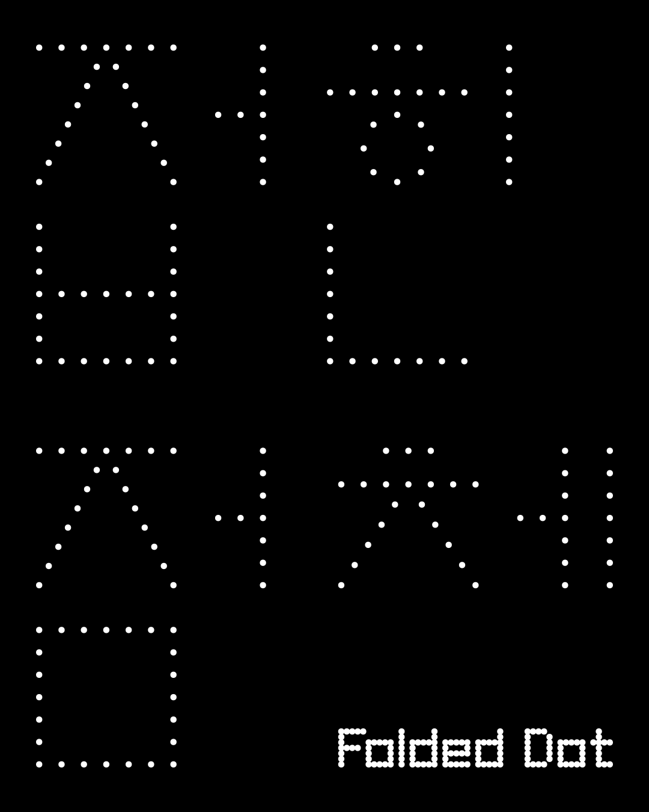
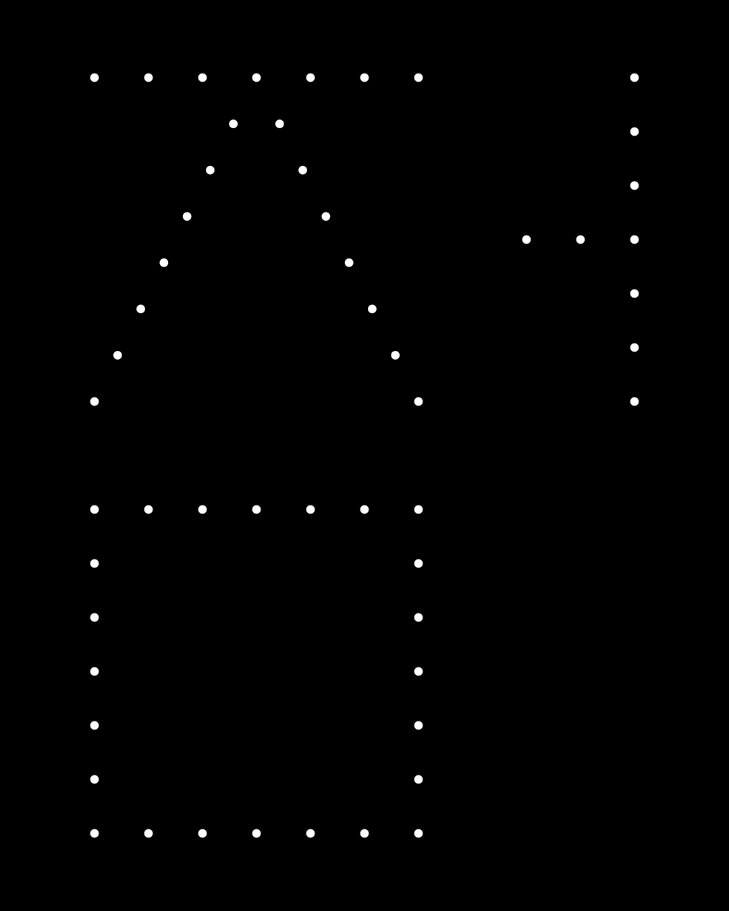
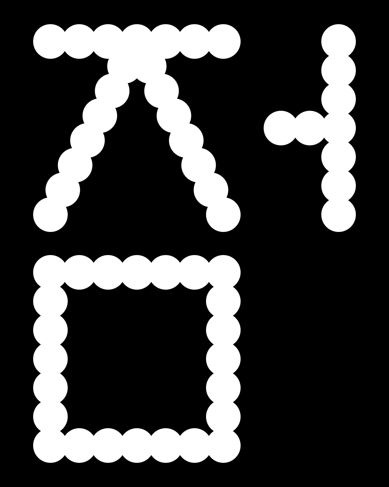
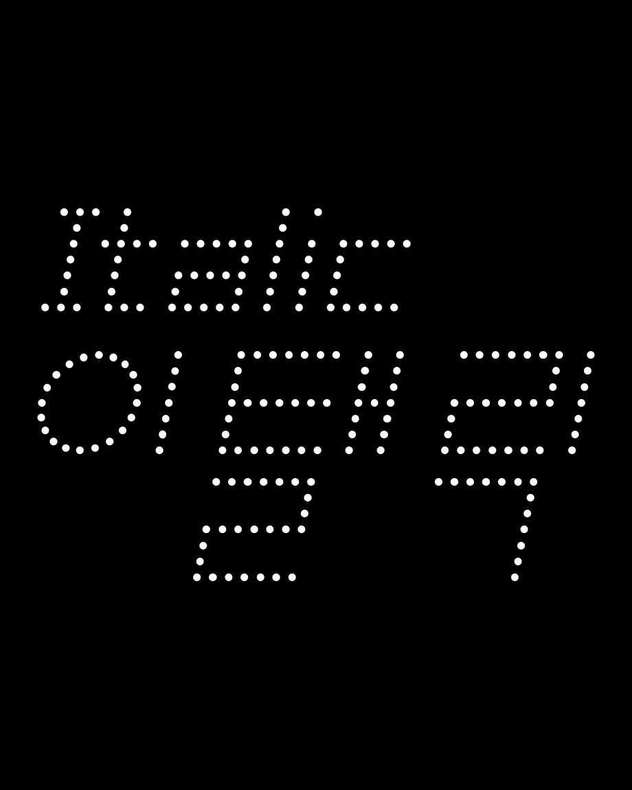
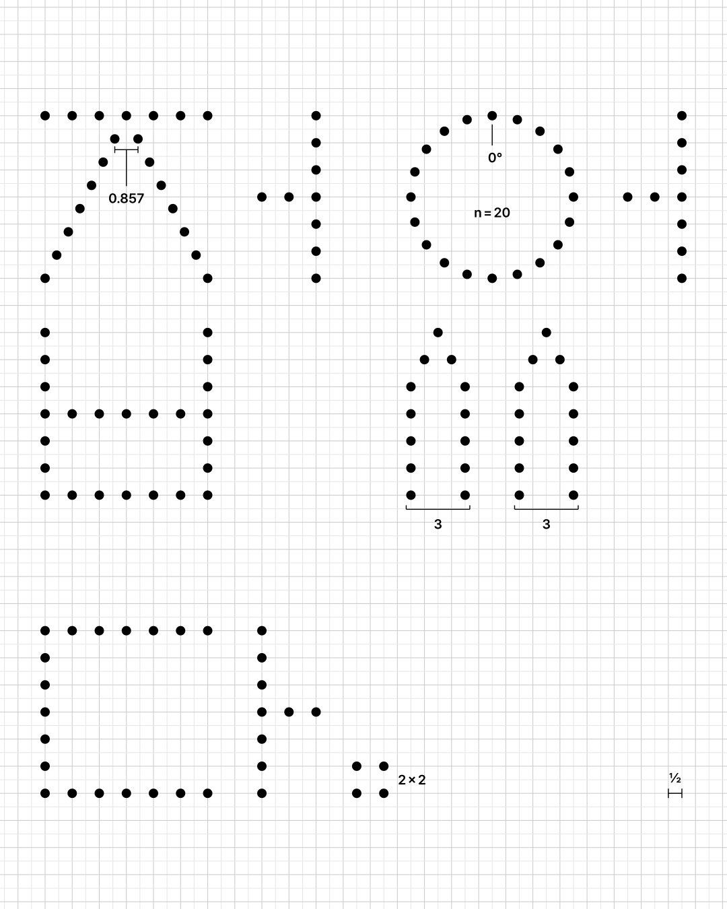
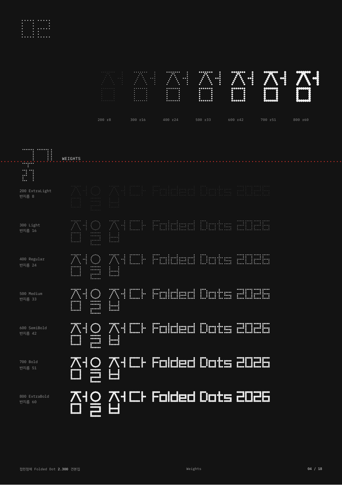
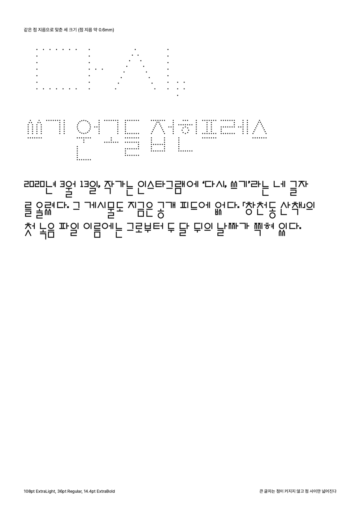

# 접힌점체 Folded Dot

<p align="center"></p>

한글 점 글꼴이다. 모든 글자를 크기가 같은 점으로만 찍고, 받침과 가로 모음은 첫 단 아래로 접어 내렸다. 시작은 1인 출판사 접힌프레스의 워드마크였다. 점으로 찍은 그 로고의 격자를 넓혀 글꼴을 짰다.

AI의 도움을 받아 만들었다. 방향과 규칙은 내가 정했고, 점 배치와 글리프 생성은 AI와 함께했다.

- **내려받기**: [folded-dot-main.zip](https://github.com/foldedpress/folded-dot/archive/refs/heads/main.zip) (늘 최신 판. OTF, TTF, 가변 TTF, 웹용 WOFF2, 사용안내, 견본 PDF)
- **소개 페이지**: [notjust.co.kr/folded-dot](https://notjust.co.kr/folded-dot/)
- **라이선스**: [SIL 오픈 폰트 라이선스 1.1](OFL.txt). 누구나 무료로 쓰고, 고치고, 다시 나눌 수 있다. 글꼴 파일만 따로 팔 수는 없다.

[English](#english)

## 글꼴

| | |
|---|---|
| 판 | 2.300 (2026년 11월 23일) |
| 굵기 | 가변 200~800, 고정 굵기 일곱 개(ExtraLight, Light, Regular, Medium, SemiBold, Bold, ExtraBold) |
| 기울임꼴 | 굵기마다 하나씩 일곱 개와 가변 기울임꼴. 격자만 11.31° 기울였다 |
| 파일 | OTF, TTF, 가변 TTF, 웹용 WOFF2 |
| 글자 | 한글 11,172자, 한글 자모 161자, 라틴 417자, 그리스 69자, 키릴 66자, KS X 1001 기호 전부, KS 한자 4,888자. 모두 17,550자 |
| 없는 글자 | 가나, 베트남어와 우크라이나어 글자 일부 |

## 굵기

<p> </p>

굵기를 올려도 점 간격은 그대로 두고 반지름만 키운다. 격자 한 칸은 늘 100(1000 기준)이다. Bold부터 점끼리 닿고, ExtraBold에서는 겹쳐서 선이 된다.

| 굵기 | 반지름 |
|---|---|
| ExtraLight 200 | 8 |
| Light 300 | 16 |
| Regular 400 | 24 |
| Medium 500 | 33 |
| SemiBold 600 | 42 |
| Bold 700 | 51 |
| ExtraBold 800 | 60 |

## 기울임꼴

<p align="center"></p>

점 모양은 그대로 두고, 점이 놓이는 격자만 기울였다. 한 단(100) 올라갈 때마다 오른쪽으로 20씩 민다. 같은 높이의 점은 모두 같은 만큼 밀리므로 글자 폭, 글자 사이, 커닝은 바로선 꼴과 같다. 바로선 꼴과 한 가족으로 묶여 있어서, 기울임꼴을 깔아 두면 Cmd+I를 눌렀을 때 프로그램이 글자를 억지로 눕히지 않고 이 기울임꼴을 쓴다.

## 점을 찍는 규칙

<p align="center"></p>

1. 획의 끝점, 꺾이는 점, 원의 중심은 반 칸 격자 위에만 둔다.
2. 획 위의 점은 끝점을 포함해 같은 간격으로 찍고, 간격은 한 칸 안팎이다.
3. 서로 다른 획의 점은 0.85칸보다 가까이 둘 수 없다. 획이 만나는 데서는 점 하나를 같이 쓴다.
4. 원은 맨 위와 맨 아래에 점이 하나씩 오게 짝수 개로 찍는다. 원의 위아래가 다른 획과 같은 격자 줄에 온다.
5. 겹자음과 겹받침은 글자를 줄이지 않는다. 3칸 폭으로 따로 짠 뼈대 두 개를 한 칸 띄워 붙인다.
6. 마침표, 쉼표, 쌍점은 2×2 점 덩어리로 찍어 획의 점과 구별한다.

한자는 본고딕(Noto Sans CJK KR)의 글자 모양에서 뼈대를 뽑아 같은 규칙으로 점을 다시 찍었다.

## 쓰는 법

| | |
|---|---|
| 제목 | ExtraLight~Regular |
| 본문 | SemiBold~Bold, 9~11pt |
| 행간 | 본문은 240% 안팎. 점이 닿지 않는 가장 좁은 값은 200%(굵기 600 이하만 쓰면 190%) |
| 자간 | 커닝을 켜고 본문 0, 제목 −50 |

받침이 세 단까지 내려가는 글자(꿈, 굴, 뚫 같은)가 있어 한 줄이 깊다. 인디자인의 자동 행간(120%)으로는 줄이 겹치니 행간은 직접 넣고, 커닝은 '메트릭'으로 둔다.

크기가 달라도 점 지름을 같게 맞추려면 크기에 따라 굵기를 바꾼다. Regular 20pt를 기준으로 하면 8pt는 800, 12pt는 578, 40pt는 250, 60pt는 200이다. 자세한 값은 [사용안내.txt](사용안내.txt)에 있다.

## 설치

OTF와 TTF, 가변과 고정 굵기는 모두 같은 이름(Folded Dot, 접힌점체)을 쓴다. 한 컴퓨터에는 한 벌만 설치한다.

| 프로그램 | 파일 |
|---|---|
| 인디자인, 일러스트레이터 | OTF 열네 개, 또는 가변 TTF 둘 |
| 피그마 | 가변 TTF 둘 |
| 워드, 한글 같은 문서 편집기 | 고정 굵기 열네 개(OTF나 TTF 가운데 하나) |
| 웹 | WOFF2 |

웹에서는 이렇게 쓴다.

```css
@font-face {
  font-family: "Folded Dot";
  src: url("FoldedDot[wght].woff2") format("woff2");
  font-weight: 200 800;
  font-style: normal;
  font-display: swap;
}
@font-face {
  font-family: "Folded Dot";
  src: url("FoldedDot-Italic[wght].woff2") format("woff2");
  font-weight: 200 800;
  font-style: italic;
  font-display: swap;
}
body { font-family: "Folded Dot"; line-height: 2.4; }
```

## 견본

<p> </p>

견본집 18쪽은 [접힌점체_견본.pdf](접힌점체_견본.pdf), 굵기 표 두 장(바로선 꼴, 기울임꼴)은 [접힌점체_굵기표.pdf](접힌점체_굵기표.pdf)에 있다.

## 폴더

| | |
|---|---|
| `OTF/` | 고정 굵기 일곱 개와 기울임꼴 일곱 개(CFF) |
| `TTF/` | 가변 글꼴 `FoldedDot[wght].ttf`, `FoldedDot-Italic[wght].ttf`와 고정 굵기 열네 개 |
| `web/` | 웹용 가변 글꼴 둘 |
| `검사/` | 품질 검사 요약과 교정쇄 |
| `FONTLOG.txt` | 출처와 판마다 바뀐 내용 |
| `사용안내.txt` | 굵기, 기울임꼴, 행간, 설치, 글자 범위 |
| `접힌점체_견본.pdf` | 견본집 18쪽 |
| `접힌점체_굵기표.pdf` | 굵기 표 두 장 |

## 라이선스

[SIL 오픈 폰트 라이선스 1.1](OFL.txt). 한자 4,888자와 기호 아홉 자(∂ ∝ ∮ ♨ ☏ ☎ ☜ ☞ ㉿)는 본고딕(Noto Sans CJK KR, © 2014-2021 Adobe)의 뼈대에서 뽑았기 때문에 글꼴 전체를 같은 라이선스로 낸다. 이 글꼴로 만든 인쇄물이나 이미지에는 라이선스가 따라붙지 않는다.

## 만든 사람

한하람, 접힌프레스 2026. [notjust.co.kr](https://notjust.co.kr)

---

## English

Folded Dot is a Korean dot typeface. Every glyph is built from dots of a single size, and final consonants and horizontal vowels fold down below the first row. It grew out of the dot grid of the Folded Press wordmark.

Made with the help of AI. Han Haram set the direction and the rules; the dot placement and glyph generation were done together with AI.

- **Download**: [folded-dot-main.zip](https://github.com/foldedpress/folded-dot/archive/refs/heads/main.zip) (always the latest version. OTF, TTF, variable TTF, WOFF2, usage notes in Korean, specimen PDF)
- **License**: [SIL Open Font License 1.1](OFL.txt)

| | |
|---|---|
| Version | 2.300 (2026-11-23) |
| Weights | Variable, wght 200 to 800, plus seven static weights |
| Italics | Seven static italics and a variable italic. Only the grid is slanted, 11.31° |
| Characters | 11,172 Hangul syllables, 161 jamo, 417 Latin, 69 Greek, 66 Cyrillic, all KS X 1001 symbols, 4,888 KS Hanja. 17,550 in total. No kana. |

The weight axis changes only the dot radius, from 8 at 200 to 60 at 800. The grid pitch stays at 100 units per 1000 UPM. Dots begin to touch at Bold and merge into lines at ExtraBold.

The italics keep every dot round and slant only the grid, 20 units per row. Dots at the same height move by the same amount, so widths, spacing and kerning match the uprights. Uprights and italics are linked as one family, so Cmd+I picks the real italic instead of a synthetic slant.

Set body text at about 240% line height. 200% is the tightest value at which dots on neighbouring lines do not touch (190% if you use weights up to 600). Turn kerning on and use tracking 0 for text and −50 for headings. Set leading by hand: the 120% auto leading in InDesign makes lines collide.

The Hanja and nine symbols were made by extracting skeletons from Noto Sans CJK KR (© 2014-2021 Adobe, SIL OFL 1.1) and re-dotting them with the same rules, so the whole font is released under the SIL Open Font License 1.1. The license does not apply to anything you make with the font.

Han Haram, Folded Press, 2026. [notjust.co.kr](https://notjust.co.kr)
